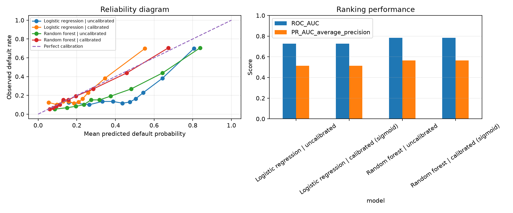

# Credit Default Prediction and Calibration

A small project that predicts which credit card clients will default, and checks whether the predicted probabilities can be trusted.

I built it to learn the difference between a model that *ranks* people well and a model whose *probabilities* are accurate. I used AI tools (Claude) to help write and debug the code, and I ran it and checked the results myself.

## The question

If a model says a client has a 20% chance of defaulting, do about 20% of those clients actually default? A model can be good at ordering clients from low to high risk and still give probabilities that are too high or too low. I wanted to see if calibration fixes that.

## Data

[Default of Credit Card Clients](https://archive.ics.uci.edu/dataset/350/default+of+credit+card+clients) from the UCI Machine Learning Repository.

* 30,000 clients from Taiwan, 23 features (credit limit, payment history, bill amounts, payments, some personal details)
* Target: default next month (22.1% defaulted)
* The code downloads the file on the first run. The raw data is not stored in this repo.

## What I did

1. Split the data into train (60%), calibration (20%) and test (20%), keeping the default rate the same in each part
2. Trained logistic regression and a random forest
3. Calibrated both with sigmoid (Platt) scaling, using the calibration set only
4. Measured everything on the test set, before and after calibration

The calibration set is separate so the models never see the data used to fix their probabilities.

## Results

Test set of 6,000 clients, seed 42.

| Model | ROC-AUC | Brier score | Log loss | ECE |
| :--- | :--- | :--- | :--- | :--- |
| Logistic regression, before | 0.727 | 0.205 | 0.600 | 0.235 |
| Logistic regression, after | 0.727 | 0.145 | 0.464 | 0.058 |
| Random forest, before | 0.785 | 0.155 | 0.484 | 0.138 |
| Random forest, after | 0.785 | 0.133 | 0.426 | 0.012 |

Lower is better for Brier score, log loss and ECE (expected calibration error). Full numbers are in `results/metrics.csv`.



**What I found**

* Calibration improved the probabilities for both models. The random forest ended up very close to the diagonal on the reliability plot.
* Calibration did not change ROC-AUC. It fixes how reliable the probabilities are, not the order of the clients.
* Before calibration, both models overestimated default risk. I think this is partly because I trained them with `class_weight="balanced"`, but I haven't tested that yet.
* Logistic regression improved a lot but is still off in some ranges, so sigmoid calibration only partly fixed it.
* After calibration, recall at the 0.5 threshold dropped (logistic regression: 0.64 to 0.20) while precision went up. The probabilities now match the real 22% default rate, so a 0.5 cutoff is much stricter. The threshold should be chosen on purpose, not left at 0.5.

## How to run it (Windows, PowerShell)

You need Python 3.10 or newer and an internet connection.

```powershell
py -3.12 -m venv .venv
.\.venv\Scripts\Activate.ps1
python -m pip install -e ".[dev]"
pip install xlrd
pytest
credit-risk
```

`xlrd` is needed to read the old `.xls` format. Results are saved to `outputs/` (the copies in `results/` are from my own run). If the download fails, put the `.xls` file from UCI in `data/raw/` as `default_of_credit_card_clients.xls`.

## Project layout

```text
src/credit_risk/
    data.py       download and check the dataset
    modeling.py   split, models, calibration, metrics
    cli.py        runs the whole experiment
tests/
    test_modeling.py
results/          metrics, chart and run details from my run
```

## Limitations

* The data is old and from Taiwan, so it says nothing about current Irish or European lending
* I used a random split, not a split by time, so this does not show how the model would do on future clients
* The results come from one split and one seed, with no confidence intervals
* The tests only check the metric and split functions with small made-up examples. The results come from the real data
* This is a learning project, not a lending tool

## Ideas for later

* Try isotonic calibration and compare it with sigmoid
* Train without `class_weight="balanced"` and see how much it changes the raw probabilities
* Repeat with several seeds or cross-validation and report ranges
* Pick a threshold using the cost of a missed default versus a wrongly rejected client
